# Qwen3.6 35B-A3B benchmarks

AMD Strix Halo `gfx1151`, 128 GB unified memory. Gufo `7b1e23a8` versus
llama.cpp `b11069` (`68d9053a`), both compiled with the pinned ROCm 7.2.3
toolchain. Targets are the Unsloth UD-Q4_K_XL / UD-Q6_K_XL / UD-Q8_K_XL files;
DFlash2 uses the aminya Q8_0 draft and MTP uses each target's own head
([files and revisions](README.md)). HTTP, greedy, thinking off. Every row
was measured on October 25, 2026.

Gufo drafts up to 7 DFlash2 tokens with its adaptive controller and 2 MTP
tokens; llama.cpp uses its default of 3 for both modes. Its repetitive MTP
rows therefore accept up to 2.88 tokens per step against Gufo's 1.91.

Every Gufo DFlash2 and MTP completion, single-user at every depth and
multi-user at every level, matches Gufo AR on all three targets, and every
multi-user AR completion matches the same prompt decoded alone (see
[Quality](QUALITY.md#benchmark-output-consistency)).

Positive gain favors Gufo.
[Quality and measurement details](QUALITY.md) · [Model identities](artifacts/model-identities.json)

## Single user, autoregressive

Approximately pp2048 / tg128; depth is the cached prefix in tokens.

<!-- bench:single-ar-q4 -->
| Qwen35B-A3B Q4 AR Depth (tokens) | Gufo pp (tok/s) | llama.cpp pp (tok/s) | Gain | Gufo tg (tok/s) | llama.cpp tg (tok/s) | Gain |
| ---: | ---: | ---: | ---: | ---: | ---: | ---: |
| 0 | 3195.02 | 1406.89 | +127.1% | 55.95 | 52.88 | +5.8% |
| 4,096 | 2950.32 | 1292.78 | +128.2% | 54.52 | 51.45 | +6.0% |
| 8,192 | 2762.46 | 1198.97 | +130.4% | 53.53 | 50.44 | +6.1% |
| 12,288 | 2544.41 | 1116.84 | +127.8% | 52.27 | 49.38 | +5.9% |
| 16,384 | 2394.29 | 1049.84 | +128.1% | 51.43 | 48.43 | +6.2% |
| 32,768 | 1923.26 | 846.06 | +127.3% | 47.86 | 45.13 | +6.0% |
| 65,536 | 1388.51 | 611.04 | +127.2% | 42.11 | 39.44 | +6.8% |
| 131,072 | 891.80 | 395.50 | +125.5% | 33.95 | 31.57 | +7.5% |
<!-- /bench -->

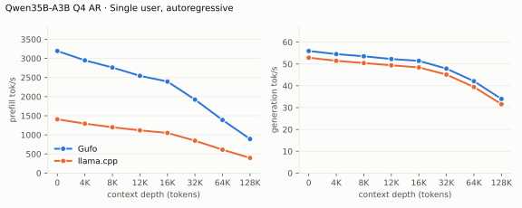

---

<!-- bench:single-ar-q6 -->
| Qwen35B-A3B Q6 AR Depth (tokens) | Gufo pp (tok/s) | llama.cpp pp (tok/s) | Gain | Gufo tg (tok/s) | llama.cpp tg (tok/s) | Gain |
| ---: | ---: | ---: | ---: | ---: | ---: | ---: |
| 0 | 3089.57 | 1244.48 | +148.3% | 55.05 | 47.99 | +14.7% |
| 4,096 | 2852.53 | 1175.64 | +142.6% | 53.78 | 47.49 | +13.2% |
| 8,192 | 2660.41 | 1100.87 | +141.7% | 52.85 | 46.87 | +12.8% |
| 12,288 | 2462.15 | 1034.19 | +138.1% | 51.69 | 45.94 | +12.5% |
| 16,384 | 2310.36 | 976.90 | +136.5% | 50.70 | 45.13 | +12.3% |
| 32,768 | 1873.21 | 797.00 | +135.0% | 47.41 | 42.17 | +12.4% |
| 65,536 | 1356.96 | 583.86 | +132.4% | 41.70 | 37.11 | +12.4% |
| 131,072 | 885.31 | 385.23 | +129.8% | 33.68 | 30.13 | +11.8% |
<!-- /bench -->

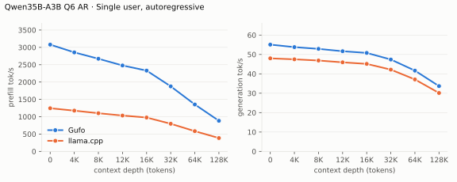

---

<!-- bench:single-ar-q8 -->
| Qwen35B-A3B Q8 AR Depth (tokens) | Gufo pp (tok/s) | llama.cpp pp (tok/s) | Gain | Gufo tg (tok/s) | llama.cpp tg (tok/s) | Gain |
| ---: | ---: | ---: | ---: | ---: | ---: | ---: |
| 0 | 2846.65 | 1285.34 | +121.5% | 52.19 | 45.77 | +14.0% |
| 4,096 | 2655.22 | 1156.16 | +129.7% | 50.95 | 45.04 | +13.1% |
| 8,192 | 2473.93 | 1096.24 | +125.7% | 50.16 | 44.23 | +13.4% |
| 12,288 | 2328.92 | 1002.01 | +132.4% | 49.12 | 44.06 | +11.5% |
| 16,384 | 2198.86 | 950.59 | +131.3% | 48.38 | 43.32 | +11.7% |
| 32,768 | 1787.75 | 774.25 | +130.9% | 45.22 | 40.57 | +11.5% |
| 65,536 | 1309.72 | 574.61 | +127.9% | 39.93 | 35.80 | +11.5% |
| 131,072 | 864.14 | 377.60 | +128.9% | 32.54 | 29.32 | +11.0% |
<!-- /bench -->

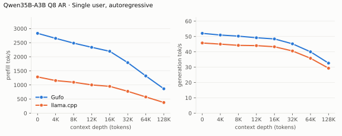

## Single user, DFlash2

pp is the highest measured rate per engine and depth across mixed/repetitive
text.

<!-- bench:single-dflash2-q4 -->
| Qwen35B-A3B Q4 DFlash2 Depth (tokens) | Gufo pp (tok/s) | llama.cpp pp (tok/s) | Gain pp | Gufo tg mixed (tok/s) | llama.cpp tg mixed (tok/s) | Gain mixed | Gufo tg repetitive (tok/s) | llama.cpp tg repetitive (tok/s) | Gain repetitive |
| ---: | ---: | ---: | ---: | ---: | ---: | ---: | ---: | ---: | ---: |
| 0 | 2965.68 | 1307.78 | +126.8% | 69.35 | 71.68 | -3.3% | 165.79 | 110.69 | +49.8% |
| 4,096 | 2617.46 | 1194.36 | +119.2% | 68.74 | 66.59 | +3.2% | 156.02 | 105.10 | +48.4% |
| 8,192 | 2500.04 | 1113.55 | +124.5% | 62.01 | 70.38 | -11.9% | 153.72 | 106.50 | +44.3% |
| 12,288 | 2359.05 | 1041.80 | +126.4% | 62.70 | 75.74 | -17.2% | 152.67 | 101.82 | +49.9% |
| 16,384 | 2214.42 | 981.11 | +125.7% | 61.42 | 66.16 | -7.2% | 133.83 | 102.91 | +30.0% |
| 32,768 | 1804.24 | 808.49 | +123.2% | 59.64 | 58.36 | +2.2% | 138.16 | 98.85 | +39.8% |
| 65,536 | 1326.74 | 589.76 | +125.0% | 52.39 | 58.65 | -10.7% | 118.78 | 79.62 | +49.2% |
| 131,072 | 852.61 | 383.37 | +122.4% | 49.54 | 46.40 | +6.8% | 101.46 | 59.31 | +71.1% |
<!-- /bench -->

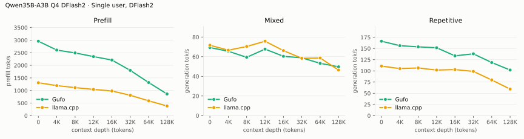

---

<!-- bench:single-dflash2-q6 -->
| Qwen35B-A3B Q6 DFlash2 Depth (tokens) | Gufo pp (tok/s) | llama.cpp pp (tok/s) | Gain pp | Gufo tg mixed (tok/s) | llama.cpp tg mixed (tok/s) | Gain mixed | Gufo tg repetitive (tok/s) | llama.cpp tg repetitive (tok/s) | Gain repetitive |
| ---: | ---: | ---: | ---: | ---: | ---: | ---: | ---: | ---: | ---: |
| 0 | 2875.90 | 1188.48 | +142.0% | 68.01 | 66.03 | +3.0% | 181.17 | 98.96 | +83.1% |
| 4,096 | 2610.46 | 1088.76 | +139.8% | 65.04 | 62.49 | +4.1% | 169.59 | 93.12 | +82.1% |
| 8,192 | 2418.80 | 1024.31 | +136.1% | 65.49 | 55.28 | +18.5% | 167.95 | 94.95 | +76.9% |
| 12,288 | 2276.96 | 963.31 | +136.4% | 63.09 | 61.68 | +2.3% | 165.27 | 91.62 | +80.4% |
| 16,384 | 2160.89 | 907.46 | +138.1% | 64.90 | 59.35 | +9.4% | 144.98 | 90.74 | +59.8% |
| 32,768 | 1765.37 | 760.81 | +132.0% | 60.27 | 53.51 | +12.6% | 149.15 | 90.82 | +64.2% |
| 65,536 | 1292.72 | 563.69 | +129.3% | 53.53 | 47.62 | +12.4% | 126.05 | 73.87 | +70.6% |
| 131,072 | 848.84 | 373.09 | +127.5% | 49.62 | 43.47 | +14.1% | 107.45 | 55.46 | +93.7% |
<!-- /bench -->

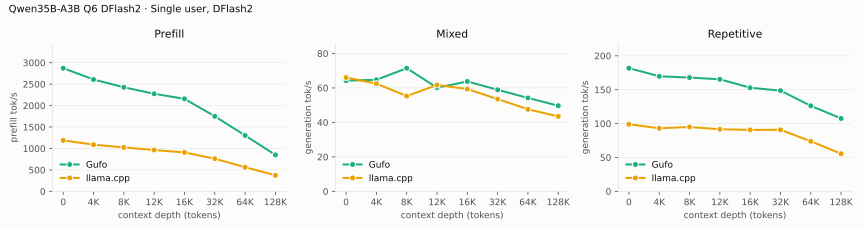

---

<!-- bench:single-dflash2-q8 -->
| Qwen35B-A3B Q8 DFlash2 Depth (tokens) | Gufo pp (tok/s) | llama.cpp pp (tok/s) | Gain pp | Gufo tg mixed (tok/s) | llama.cpp tg mixed (tok/s) | Gain mixed | Gufo tg repetitive (tok/s) | llama.cpp tg repetitive (tok/s) | Gain repetitive |
| ---: | ---: | ---: | ---: | ---: | ---: | ---: | ---: | ---: | ---: |
| 0 | 2658.02 | 1212.36 | +119.2% | 65.44 | 63.24 | +3.5% | 174.06 | 90.83 | +91.6% |
| 4,096 | 2431.69 | 1110.30 | +119.0% | 62.85 | 61.97 | +1.4% | 162.00 | 86.48 | +87.3% |
| 8,192 | 2287.95 | 1024.27 | +123.4% | 65.68 | 56.42 | +16.4% | 161.97 | 86.62 | +87.0% |
| 12,288 | 2160.80 | 965.17 | +123.9% | 62.29 | 63.03 | -1.2% | 159.29 | 83.94 | +89.8% |
| 16,384 | 2041.08 | 908.96 | +124.6% | 65.56 | 58.73 | +11.6% | 147.61 | 85.59 | +72.5% |
| 32,768 | 1680.84 | 755.08 | +122.6% | 55.01 | 52.81 | +4.2% | 143.98 | 83.36 | +72.7% |
| 65,536 | 1266.57 | 561.23 | +125.7% | 52.43 | 47.03 | +11.5% | 121.36 | 68.52 | +77.1% |
| 131,072 | 828.15 | 371.68 | +122.8% | 50.99 | 41.63 | +22.5% | 104.32 | 52.15 | +100.0% |
<!-- /bench -->

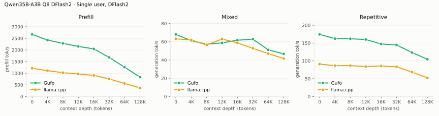

## Single user, MTP

The GGUF's own MTP head on both engines. pp is the highest measured rate per
engine and depth across mixed/repetitive text.

<!-- bench:single-mtp-q4 -->
| Qwen35B-A3B Q4 MTP Depth (tokens) | Gufo pp (tok/s) | llama.cpp pp (tok/s) | Gain pp | Gufo tg mixed (tok/s) | llama.cpp tg mixed (tok/s) | Gain mixed | Gufo tg repetitive (tok/s) | llama.cpp tg repetitive (tok/s) | Gain repetitive |
| ---: | ---: | ---: | ---: | ---: | ---: | ---: | ---: | ---: | ---: |
| 0 | 3106.73 | 1353.27 | +129.6% | 70.46 | 71.58 | -1.6% | 92.96 | 106.80 | -13.0% |
| 4,096 | 2849.49 | 1215.60 | +134.4% | 69.56 | 70.78 | -1.7% | 91.07 | 103.84 | -12.3% |
| 8,192 | 2639.16 | 1108.04 | +138.2% | 70.11 | 71.83 | -2.4% | 88.11 | 101.56 | -13.2% |
| 12,288 | 2466.63 | 1032.26 | +139.0% | 65.60 | 67.19 | -2.4% | 85.83 | 99.91 | -14.1% |
| 16,384 | 2314.08 | 966.42 | +139.4% | 65.81 | 69.09 | -4.7% | 84.29 | 98.58 | -14.5% |
| 32,768 | 1868.08 | 780.33 | +139.4% | 61.90 | 56.30 | +9.9% | 77.77 | 91.41 | -14.9% |
| 65,536 | 1358.43 | 558.58 | +143.2% | 50.13 | 51.16 | -2.0% | 67.01 | 77.66 | -13.7% |
| 131,072 | 877.75 | 358.22 | +145.0% | 40.15 | 42.46 | -5.4% | 51.55 | 62.78 | -17.9% |
<!-- /bench -->

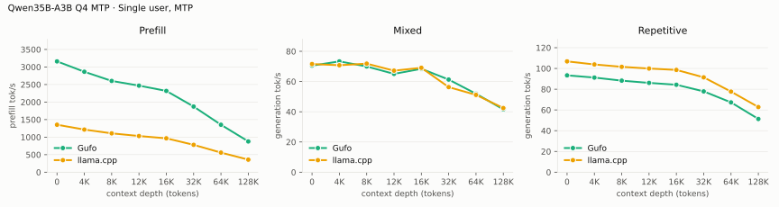

---

<!-- bench:single-mtp-q6 -->
| Qwen35B-A3B Q6 MTP Depth (tokens) | Gufo pp (tok/s) | llama.cpp pp (tok/s) | Gain pp | Gufo tg mixed (tok/s) | llama.cpp tg mixed (tok/s) | Gain mixed | Gufo tg repetitive (tok/s) | llama.cpp tg repetitive (tok/s) | Gain repetitive |
| ---: | ---: | ---: | ---: | ---: | ---: | ---: | ---: | ---: | ---: |
| 0 | 3050.12 | 1229.36 | +148.1% | 67.37 | 55.92 | +20.5% | 94.98 | 95.74 | -0.8% |
| 4,096 | 2756.32 | 1103.94 | +149.7% | 69.28 | 64.00 | +8.3% | 92.94 | 92.96 | -0.0% |
| 8,192 | 2532.56 | 1018.04 | +148.8% | 71.39 | 64.82 | +10.1% | 89.91 | 90.98 | -1.2% |
| 12,288 | 2397.55 | 958.12 | +150.2% | 68.19 | 57.52 | +18.6% | 87.38 | 88.10 | -0.8% |
| 16,384 | 2258.32 | 895.61 | +152.2% | 69.74 | 63.87 | +9.2% | 86.32 | 88.42 | -2.4% |
| 32,768 | 1825.95 | 736.49 | +147.9% | 62.25 | 56.45 | +10.3% | 79.09 | 82.56 | -4.2% |
| 65,536 | 1345.28 | 536.13 | +150.9% | 50.30 | 46.05 | +9.2% | 68.18 | 72.56 | -6.0% |
| 131,072 | 866.30 | 346.69 | +149.9% | 41.91 | 36.02 | +16.4% | 51.93 | 57.91 | -10.3% |
<!-- /bench -->

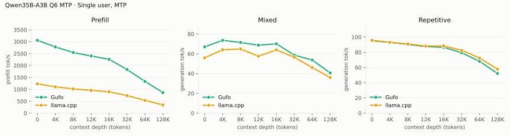

---

<!-- bench:single-mtp-q8 -->
| Qwen35B-A3B Q8 MTP Depth (tokens) | Gufo pp (tok/s) | llama.cpp pp (tok/s) | Gain pp | Gufo tg mixed (tok/s) | llama.cpp tg mixed (tok/s) | Gain mixed | Gufo tg repetitive (tok/s) | llama.cpp tg repetitive (tok/s) | Gain repetitive |
| ---: | ---: | ---: | ---: | ---: | ---: | ---: | ---: | ---: | ---: |
| 0 | 2821.27 | 1254.59 | +124.9% | 63.81 | 59.00 | +8.2% | 88.58 | 88.43 | +0.2% |
| 4,096 | 2541.91 | 1138.95 | +123.2% | 68.37 | 60.48 | +13.0% | 86.88 | 86.43 | +0.5% |
| 8,192 | 2405.36 | 1020.49 | +135.7% | 70.69 | 59.78 | +18.3% | 84.03 | 85.00 | -1.1% |
| 12,288 | 2261.74 | 956.13 | +136.6% | 65.56 | 53.75 | +22.0% | 82.01 | 83.53 | -1.8% |
| 16,384 | 2133.22 | 894.66 | +138.4% | 67.95 | 58.97 | +15.2% | 81.17 | 82.95 | -2.1% |
| 32,768 | 1736.77 | 731.51 | +137.4% | 58.77 | 54.15 | +8.5% | 74.55 | 77.29 | -3.5% |
| 65,536 | 1298.06 | 528.60 | +145.6% | 51.03 | 45.34 | +12.5% | 64.75 | 67.10 | -3.5% |
| 131,072 | 846.52 | 346.35 | +144.4% | 38.98 | 36.09 | +8.0% | 49.86 | 54.62 | -8.7% |
<!-- /bench -->

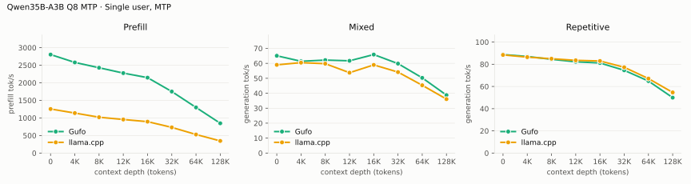

## Multiple users, autoregressive

Same pp2048 prose prompt as single-user d0, tg128, context 4096 per user.
Every session is prefilled before timed decoding; throughput sums individual
request decode rates.

<!-- bench:multi-ar-q4 -->
| Qwen35B-A3B Q4 AR Users | Gufo AR (tok/s) | llama.cpp AR (tok/s) | Gain |
| ---: | ---: | ---: | ---: |
| 1 | 56.06 | 52.81 | +6.2% |
| 2 | 88.39 | 85.42 | +3.5% |
| 4 | 128.17 | 136.37 | -6.0% |
| 6 | 152.03 | 150.53 | +1.0% |
| 8 | 165.78 | 170.00 | -2.5% |
<!-- /bench -->

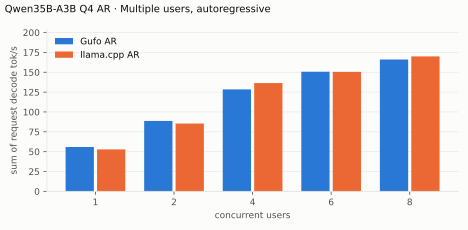

---

<!-- bench:multi-ar-q6 -->
| Qwen35B-A3B Q6 AR Users | Gufo AR (tok/s) | llama.cpp AR (tok/s) | Gain |
| ---: | ---: | ---: | ---: |
| 1 | 55.09 | 48.24 | +14.2% |
| 2 | 92.45 | 81.70 | +13.2% |
| 4 | 139.84 | 124.43 | +12.4% |
| 6 | 171.66 | 138.28 | +24.1% |
| 8 | 192.01 | 148.36 | +29.4% |
<!-- /bench -->

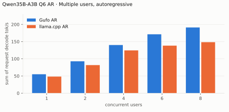

---

<!-- bench:multi-ar-q8 -->
| Qwen35B-A3B Q8 AR Users | Gufo AR (tok/s) | llama.cpp AR (tok/s) | Gain |
| ---: | ---: | ---: | ---: |
| 1 | 52.17 | 46.52 | +12.1% |
| 2 | 89.57 | 71.36 | +25.5% |
| 4 | 144.71 | 106.06 | +36.4% |
| 6 | 184.79 | 125.10 | +47.7% |
| 8 | 212.93 | 142.36 | +49.6% |
<!-- /bench -->

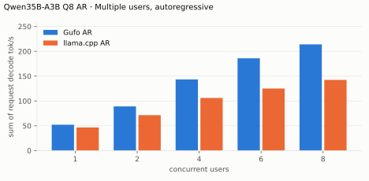

## Multiple users, DFlash2

Same pp2048 mixed/repetitive prompts as single-user d0, tg128, context 4096
per user. Every session is prefilled before timed decoding.

<!-- bench:multi-dflash2-q4 -->
| Qwen35B-A3B Q4 DFlash2 Users | Gufo mixed (tok/s) | llama.cpp mixed (tok/s) | Gain | Gufo repetitive (tok/s) | llama.cpp repetitive (tok/s) | Gain |
| ---: | ---: | ---: | ---: | ---: | ---: | ---: |
| 1 | 68.62 | 71.29 | -3.7% | 164.23 | 109.64 | +49.8% |
| 2 | 97.75 | 97.96 | -0.2% | 156.37 | 151.40 | +3.3% |
| 4 | 127.20 | 130.69 | -2.7% | 169.65 | 163.99 | +3.5% |
| 6 | 130.32 | 152.11 | -14.3% | 165.75 | 199.36 | -16.9% |
| 8 | 139.33 | 166.10 | -16.1% | 176.81 | 227.83 | -22.4% |
<!-- /bench -->

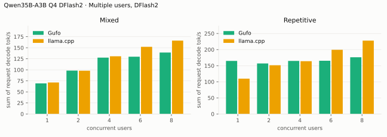

---

<!-- bench:multi-dflash2-q6 -->
| Qwen35B-A3B Q6 DFlash2 Users | Gufo mixed (tok/s) | llama.cpp mixed (tok/s) | Gain | Gufo repetitive (tok/s) | llama.cpp repetitive (tok/s) | Gain |
| ---: | ---: | ---: | ---: | ---: | ---: | ---: |
| 1 | 67.95 | 67.80 | +0.2% | 180.15 | 99.51 | +81.0% |
| 2 | 106.67 | 87.30 | +22.2% | 169.67 | 133.80 | +26.8% |
| 4 | 134.59 | 123.51 | +9.0% | 190.58 | 156.25 | +22.0% |
| 6 | 137.69 | 148.31 | -7.2% | 189.52 | 186.66 | +1.5% |
| 8 | 147.67 | 158.16 | -6.6% | 208.98 | 207.36 | +0.8% |
<!-- /bench -->

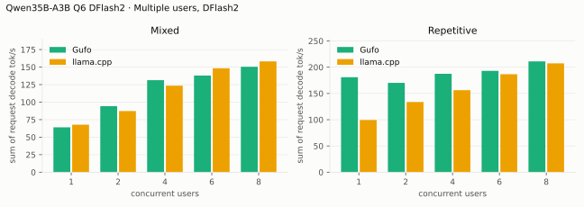

---

<!-- bench:multi-dflash2-q8 -->
| Qwen35B-A3B Q8 DFlash2 Users | Gufo mixed (tok/s) | llama.cpp mixed (tok/s) | Gain | Gufo repetitive (tok/s) | llama.cpp repetitive (tok/s) | Gain |
| ---: | ---: | ---: | ---: | ---: | ---: | ---: |
| 1 | 65.34 | 62.75 | +4.1% | 173.04 | 89.99 | +92.3% |
| 2 | 102.47 | 81.50 | +25.7% | 168.26 | 142.68 | +17.9% |
| 4 | 142.53 | 113.51 | +25.6% | 185.62 | 147.69 | +25.7% |
| 6 | 149.45 | 126.99 | +17.7% | 207.86 | 173.99 | +19.5% |
| 8 | 166.72 | 147.45 | +13.1% | 233.92 | 189.30 | +23.6% |
<!-- /bench -->

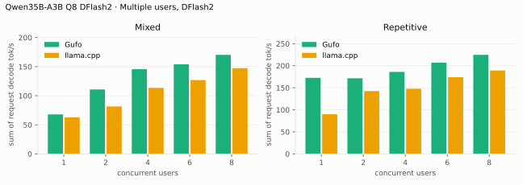

## Multiple users, MTP

Same prompts and method as the DFlash2 table.

<!-- bench:multi-mtp-q4 -->
| Qwen35B-A3B Q4 MTP Users | Gufo mixed (tok/s) | llama.cpp mixed (tok/s) | Gain | Gufo repetitive (tok/s) | llama.cpp repetitive (tok/s) | Gain |
| ---: | ---: | ---: | ---: | ---: | ---: | ---: |
| 1 | 70.28 | 71.01 | -1.0% | 92.83 | 106.69 | -13.0% |
| 2 | 96.55 | 96.44 | +0.1% | 109.78 | 116.20 | -5.5% |
| 4 | 125.02 | 130.00 | -3.8% | 124.51 | 125.09 | -0.5% |
| 6 | 148.13 | 151.92 | -2.5% | 147.90 | 134.24 | +10.2% |
| 8 | 160.25 | 171.86 | -6.8% | 159.31 | 146.10 | +9.0% |
<!-- /bench -->

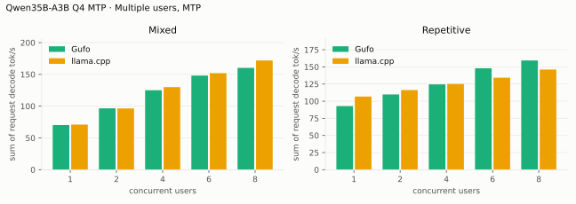

---

<!-- bench:multi-mtp-q6 -->
| Qwen35B-A3B Q6 MTP Users | Gufo mixed (tok/s) | llama.cpp mixed (tok/s) | Gain | Gufo repetitive (tok/s) | llama.cpp repetitive (tok/s) | Gain |
| ---: | ---: | ---: | ---: | ---: | ---: | ---: |
| 1 | 67.09 | 59.63 | +12.5% | 93.51 | 95.81 | -2.4% |
| 2 | 97.41 | 92.55 | +5.3% | 114.06 | 100.17 | +13.9% |
| 4 | 136.33 | 110.24 | +23.7% | 131.61 | 128.68 | +2.3% |
| 6 | 164.73 | 136.14 | +21.0% | 160.17 | 113.82 | +40.7% |
| 8 | 183.09 | 143.40 | +27.7% | 182.51 | 134.93 | +35.3% |
<!-- /bench -->

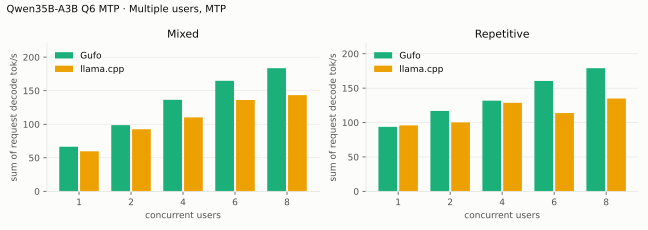

---

<!-- bench:multi-mtp-q8 -->
| Qwen35B-A3B Q8 MTP Users | Gufo mixed (tok/s) | llama.cpp mixed (tok/s) | Gain | Gufo repetitive (tok/s) | llama.cpp repetitive (tok/s) | Gain |
| ---: | ---: | ---: | ---: | ---: | ---: | ---: |
| 1 | 62.97 | 59.64 | +5.6% | 87.71 | 88.41 | -0.8% |
| 2 | 99.82 | 81.48 | +22.5% | 113.60 | 91.26 | +24.5% |
| 4 | 140.54 | 107.25 | +31.0% | 140.03 | 107.06 | +30.8% |
| 6 | 177.13 | 129.17 | +37.1% | 167.30 | 109.75 | +52.4% |
| 8 | 202.45 | 144.96 | +39.7% | 191.80 | 126.52 | +51.6% |
<!-- /bench -->

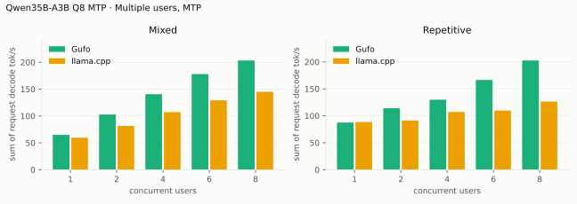

## Loading time

C1, context capacity 133760, DFlash2. Cold target/draft files to HTTP readiness.

<!-- bench:loading -->
| Qwen35B-A3B Target | Gufo ready (s) | llama.cpp ready (s) | Gain |
| --- | ---: | ---: | ---: |
| Q4 | 9.97 | 9.57 | -4.0% |
| Q6 | 13.96 | 13.16 | -5.7% |
| Q8 | 16.51 | 15.34 | -7.1% |
<!-- /bench -->

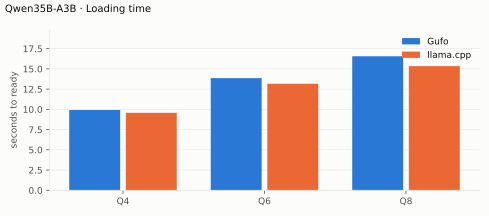

## Memory occupation

C1, context capacity 133760, AR. Peak memory reported by HIP. llama-server
allocates its KV cache up front, so its peak does not grow with the prefix.

<!-- bench:memory-q4 -->
| Qwen35B-A3B Q4 AR Workload | Gufo GiB | llama.cpp GiB | Gain |
| --- | ---: | ---: | ---: |
| pp2048 + tg128 | 31.34 | 26.64 | -15.0% |
| 16K prefix, pp4096 + tg128 | 32.34 | 26.81 | -17.1% |
<!-- /bench -->

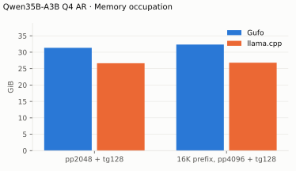

---

<!-- bench:memory-q6 -->
| Qwen35B-A3B Q6 AR Workload | Gufo GiB | llama.cpp GiB | Gain |
| --- | ---: | ---: | ---: |
| pp2048 + tg128 | 40.68 | 35.50 | -12.7% |
| 16K prefix, pp4096 + tg128 | 41.68 | 35.68 | -14.4% |
<!-- /bench -->

---

<!-- bench:memory-q8 -->
| Qwen35B-A3B Q8 AR Workload | Gufo GiB | llama.cpp GiB | Gain |
| --- | ---: | ---: | ---: |
| pp2048 + tg128 | 46.72 | 41.46 | -11.3% |
| 16K prefix, pp4096 + tg128 | 47.72 | 41.64 | -12.7% |
<!-- /bench -->

